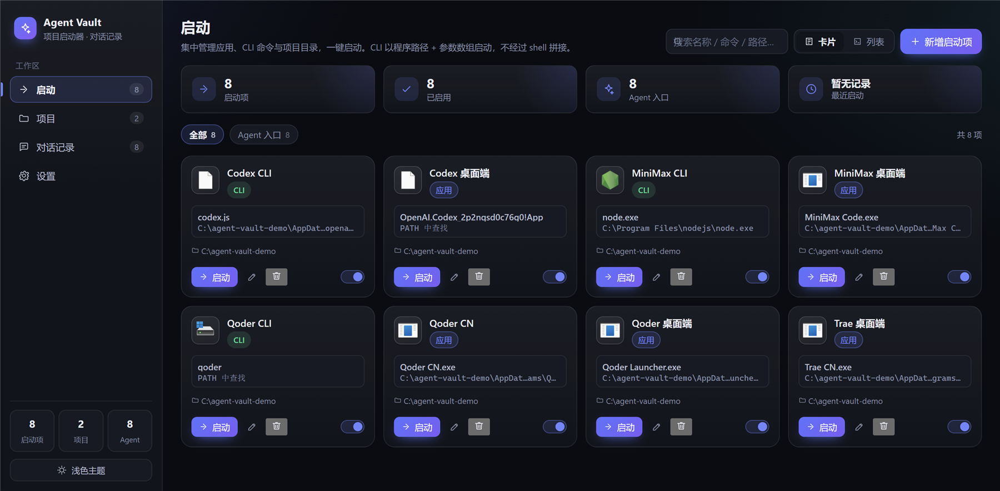

# Agent Vault · 项目启动器与 Agent 对话记录管理器

Windows 本地桌面工具：集中启动应用、CLI 与项目目录，按 Agent 和项目查看已有对话记录。

**当前版本为 0.1.0 测试版，仅支持 Windows 10 / 11 x64。** 不需要账号，也不需要配置 API Key。



## 普通用户：下载与首次使用

1. 前往 [Releases](https://github.com/woluoleiqingxvlingsui/agent-vault/releases)；如尚无 Release，可按后面的步骤从源码构建。
2. 推荐下载 `Agent Vault-0.1.0-x64.exe` 安装包，运行后可选择安装目录并创建快捷方式。
3. 不想安装可选 `Agent Vault-0.1.0-portable.exe`。**便携版表示免安装，数据仍保存在 AppData，不随 exe 移动。**
4. 使用这两种 exe 均无需额外安装 Node.js、npm 或编译工具。要启动某个外部 Agent，仍需自行安装该 Agent 及其所需运行环境。
5. 首次启动先选择要汇总的来源，再点击“保存范围并开始扫描”；也可“暂不扫描”。确认前不会读取会话正文。旧版本升级后首次使用同样需要确认。
6. 到“项目”登记根目录，已有会话按路径自动归组；到“设置 → 编辑启动配置与能力原因”修改程序、参数及工作目录。

安装包未配置代码签名，Windows 可能提示未知发布者。请核实文件来源。当前版本没有自动更新功能。

## 隐私：启动之前需要知道的事

- 主进程没有上传接口、遥测或账号体系，查看已导入记录无需联网。外部 Agent 启动后的联网行为由其自身控制。
- 勾选来源后，本应用会把**会话正文、来源路径与元数据**复制进本机数据库，**未加密保存**。
- 原始 Agent 文件只读访问，不回写、不删除。Qoder SQLite 先复制到临时目录，在副本上解析，用完清理。
- 自动扫描可在设置中暂停；正在执行的扫描会完成。暂停后仍可手动扫描已选来源。
- 取消勾选只停止后续自动扫描，不删除已经导入的内容。
- 数据目录为 `%APPDATA%\project-launcher-agent-vault\`；确切位置以“设置 → 本地数据”为准。
- 卸载或删除便携 exe 不会自动删除 AppData。需要清理时先备份、退出应用，再手动清理数据目录。
- 导出、备份和自动生成的恢复前备份均可能含完整聊天记录。请勿上传到公开仓库或作为公开 issue 附件。

仓库截图与 fixture 使用演示数据，未包含运行数据库。`.gitignore` 排除了常见数据库、会话原文件、默认命名导出、证书和私钥，但无法识别任意重命名的敏感文件；提交前仍应检查暂存文件。

## 功能与操作

| 页面 | 操作 |
| --- | --- |
| 启动 | 新增、编辑、启用/禁用应用、CLI 或项目目录；搜索、卡片/列表视图；一键启动 |
| 项目 | 登记根目录、关联启动项、重新归组；取消关联可正常保存 |
| 对话记录 | Agent/项目筛选、标题与正文搜索、时间排序、详情阅读、手动归组；每批 300 条，支持加载更多 |
| 设置 | 扫描范围、暂停扫描、来源浏览/编辑、启动配置与测试、会话导入导出、完整备份与恢复、独立演示 |

CLI 参数按数组保存，界面中一行填写一个参数。例如 `--port` 和 `3000` 各占一行。工作目录填写文件夹；程序路径使用文件选择器可避免空格路径填写错误。

启动命令可使用绝对路径，或 PATH 中的命令名，如 `node` / `node.exe`。`.cmd` / `.bat` 由 cmd.exe 执行，`.js` 由本机 Node 执行。CLI 优先使用可探测到的 Windows Terminal，否则普通启动。

用户保存的启动命令、参数与工作目录重启后保留。程序搬家或升级导致路径变化时，请在设置中更新。设置页和启动页编辑的是同一个启动项。

项目按目录边界和最长路径匹配，手动归属优先；“自动归组”清除手动覆盖，“未分组”强制保持未分组。项目根目录修改后重新计算自动归组。

对话中的代码块有单独显示，部分 Agent 注入标签默认折叠，长消息可展开；正文按文本展示，不执行其中的脚本或命令。侧边栏可切换深浅主题。

## Agent 支持范围

以下格式基于开发环境中的样本和解析测试；各 Agent 版本、安装渠道和数据格式可能不同。界面能力状态由本机配置与来源探测决定，不代表其他电脑已验证。

| Agent | 默认记录来源 | 自动记录能力 |
| --- | --- | --- |
| Qoder CN | `%APPDATA%\com.qodercn.app.stable\main.sqlite` | SQLite 会话表，支持增量扫描 |
| Qoder 桌面端 | `%APPDATA%\com.qoder.app.stable\main.sqlite` | 同类 SQLite 表结构，支持增量扫描 |
| Codex 桌面端 / CLI | `%USERPROFILE%\.codex\sessions` 下 `.jsonl.zst` | 按 originator 区分，支持增量扫描 |
| MiniMax CLI（pi 格式） | `%USERPROFILE%\.pi\agent\sessions` 下 `.jsonl` | 支持增量扫描；不是任意 MiniMax CLI 格式的通用解析器 |
| MiniMax 桌面端 | `%USERPROFILE%\.minimax\v2\sessions` | `messages.jsonl` + `manifest.json`，支持增量扫描 |
| Qoder CLI | `%USERPROFILE%\.qoder-cli` | 开发环境未发现可验证正文格式，仅保留启动与通用导入 |
| Trae CN | `%APPDATA%\Trae CN\ModularData\ai-agent\database.db` | 开发环境为私有格式，暂不自动解析 |

修改来源路径后文件监听重建；共用目录会通知相关 Agent。文件事件采用防抖，另有约 60 秒轮询兜底。Qoder 把 WAL 变更计入扫描判断；来源忙碌时可能需等待或手动重扫。

“可启动”通常表示目标文件已定位；MSIX 表示已配置应用入口，实际安装与启动结果仍需通过“保存并测试启动”核实。

## 会话导出与完整备份：用途不同

| 操作 | 包含什么 | 使用场景 |
| --- | --- | --- |
| 导出 JSON | 会话、消息时间戳、来源元数据、项目路径与手动归属 | 交换或归档会话；不包含启动项、扫描设置和全部应用配置 |
| 导出 Markdown | 可读正文、部分来源与项目信息 | 人工阅读与交换；会丢失消息时间戳、原始元数据、自动/手动归组区别及正文首尾空白等 |
| 完整备份数据库 | 启动项、项目、会话、来源设置、扫描范围等数据库内容 | 恢复应用数据；主题选择等 localStorage 界面偏好不在其中 |

### 完整备份与恢复

1. 设置 → “完整备份数据库”，另存为 `.db`。应用通过 SQLite 一致性快照生成，不直接复制活跃主库，包含已提交的 WAL 数据。
2. 恢复时选择“从完整备份恢复”，选择 `.db` 并确认。JSON / Markdown 会话导出不能用作完整备份。
3. 应用先验证完整性与版本，在当前数据目录的 `backups/` 保存恢复前备份，准备迁移后的副本，再重启应用替换数据库。
4. 恢复会替换启动项、项目、设置和会话，不影响外部 Agent 原始文件。跨电脑恢复后请检查程序和来源路径。
5. 损坏、非本应用数据库或更高版本备份会拒绝恢复。恢复过程失败时保留当前数据；若启动阶段替换失败，保留回滚文件并报告错误。

恢复前备份不会自动清理，请自行保管或在退出应用后清理。不要把备份保存到当前正在使用的 `agent-vault.db`。

### 会话导入与去重

设置页选择 JSON 或 Markdown 文件导入，显示新增、更新、跳过、失败数量以及失败原因。部分失败时成功条目仍保留，可修正失败条目后再次导入。

身份优先级：`Agent + 外部会话 ID` → `Agent + 来源路径` → `Agent + 标题和消息内容指纹`。前两者相同且内容变化时更新原记录；没有稳定标识时仅对完全相同的标题和消息角色/正文去重，修改内容后可能形成新会话。

JSON 格式版本为 1，示例：

```json
{
  "version": 1,
  "projects": [],
  "sessions": [{
    "agentId": "codex-cli",
    "externalId": "example-session-1",
    "title": "安装示例",
    "createdAt": 1793520000000,
    "updatedAt": 1793520001000,
    "sourcePath": "",
    "sourceCwd": null,
    "manualProjectId": null,
    "rawMeta": {},
    "messages": [{ "role": "user", "content": "如何安装？", "createdAt": 1793520000000 }]
  }]
}
```

Markdown 使用 `# 会话标题`、`- agent: codex-cli`、`## user` / `## assistant`，多个会话以 `---` 分隔。建议先导出一份作为格式模板。导出会转义正文中的标题和分隔线，避免破坏会话边界。

## 独立演示模式

设置 → “打开独立演示模式”，应用重启到 `%TEMP%\agent-vault-demo-app`，显示虚构会话及演示标记。此模式不读取真实 Agent 记录，也不启动外部程序；演示修改只保存在演示目录。点击顶部“退出演示并返回个人数据”重启回正常模式。

演示模式不会改写个人数据库。演示文件可能被系统临时清理，下次进入会重新补充示例会话。

## 从源码运行

需要 Windows 10 / 11 x64、**Node.js ≥22.16（推荐 22.x 或 24.x）**、npm ≥10。Node 需要内置 SQLite 和 zstd；无需 Visual Studio 编译工具。

```powershell
npm ci
npm run dev
```

在 Electron 窗口中进入独立演示模式即可体验，无需修改环境变量。开发命令：

```powershell
npm run typecheck    # 主进程、渲染层、测试与 scripts 类型检查
npm test             # 自动化测试
npm run verify       # 类型检查 + 测试
npm run build        # 构建 out/
npm start            # 预览构建
```

源码安装和构建需要下载依赖；应用查看已导入记录不依赖网络。网络不稳定时可在当前 PowerShell 设置镜像后安装：

```powershell
$env:npm_config_registry = 'https://registry.npmmirror.com'
$env:ELECTRON_MIRROR = 'https://npmmirror.com/mirrors/electron/'
$env:ELECTRON_BUILDER_BINARIES_MIRROR = 'https://npmmirror.com/mirrors/electron-builder-binaries/'
npm ci
```

## 构建与 GitHub 发布

```powershell
npm run pack:dir      # 目录版
npm run pack:nsis     # 安装包
npm run pack:portable # 便携单文件
npm run release       # 验证 + 构建 + NSIS/便携打包
```

产物在 `release/`，不纳入 Git。打包只收集 `out/` 与应用包信息，不打包 AppData 数据库。

CI 对 main 的 push / PR 执行检查与构建。Release workflow 在 `v*` tag 上运行完整 release 命令，再上传 exe；手动触发只生成 artifact。远程工作流是否成功，以 GitHub Actions 实际结果为准。

维护者确认代码、隐私与版本号后再创建 tag。当前对话中的本地修改不会自动提交、推送或发布。

## 常见问题与限制

- 找不到启动程序：在设置中选择实际程序；PATH 命令可带扩展名；修改 PATH 后重启本应用。
- MiniMax CLI 只打开 Node：检查 pi CLI 是否安装，并把 CLI 脚本路径作为参数，不能只配置 Node 程序。
- 扫描不到记录：先启用来源范围，再选择真实目录或 SQLite 文件，检查格式是否受支持。没有安装的 Agent 不必启用。
- 自动扫描无变化：检查是否暂停；等待轮询，或手动重新扫描已选来源。
- Codex 当前只解析 `.jsonl.zst`；不支持的其它格式不会宣称已同步。
- MiniMax 桌面端没有可用 cwd 的会话默认未分组，可手动调整。
- 搜索为本地 LIKE 子串匹配，无分词与语义检索。大量会话建议搭配筛选。
- 来源中的会话删除后，重新解析该来源时对应本地记录可能被清理；本工具不是源端删除后的永久档案，应另做备份。整个来源文件消失不会保证同步删除。
- 标题可能取首条用户消息；正文只支持代码块等有限展示，不是完整 Markdown 渲染。
- 数据未加密，不适合作为共享电脑上的私密聊天保险箱。
- Windows Terminal 与第三方 Agent 的实际行为取决于安装环境；测试通过不代表覆盖所有版本和设备。

## 测试、贡献与许可证

测试覆盖适配器解析、增量扫描、归组、去重、导入导出、启动、配置保留、扫描范围、共用目录监听及完整备份恢复。真实数据验证脚本与截图复现见 [开发与验收](docs/DEVELOPMENT.md)。

欢迎 issue / PR。请提供脱敏样本和复现步骤，提交前运行 `npm run verify`。真实会话、日志、导出、数据库及密钥不能作为公开样本。新增适配器需附格式样本测试，并注明验证环境。

技术栈：Electron 38、React 19、TypeScript、Node 内置 SQLite；主进程管理本地数据，渲染层经受限 preload IPC 交互，启用 sandbox/contextIsolation，关闭 nodeIntegration。

历史设计见 [设计方案](docs/设计方案.md)，当前行为以代码和本 README 为准。交互与本地存储思路参考 Cherry Studio、Chatbox、Jan，未将它们的实现代码引入本项目。

[MIT](LICENSE) © 2026 woluoleiqingxvlingsui
