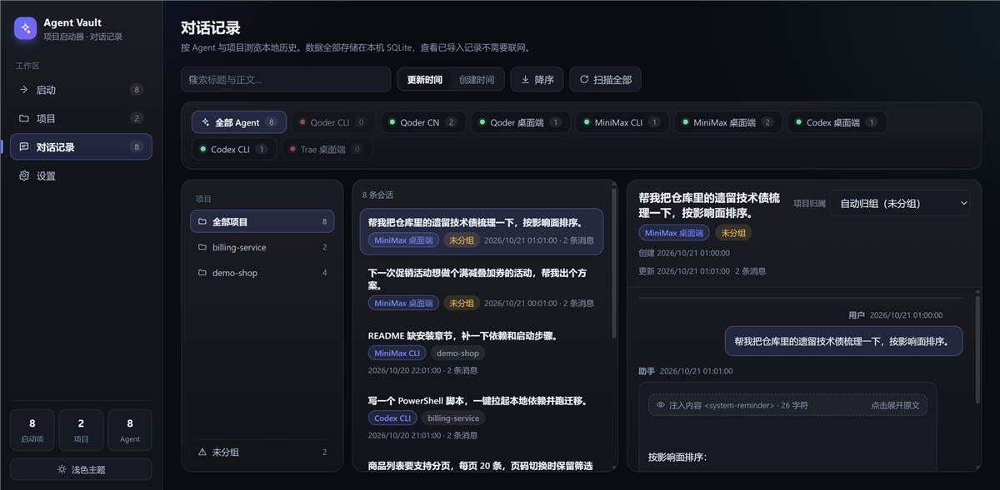
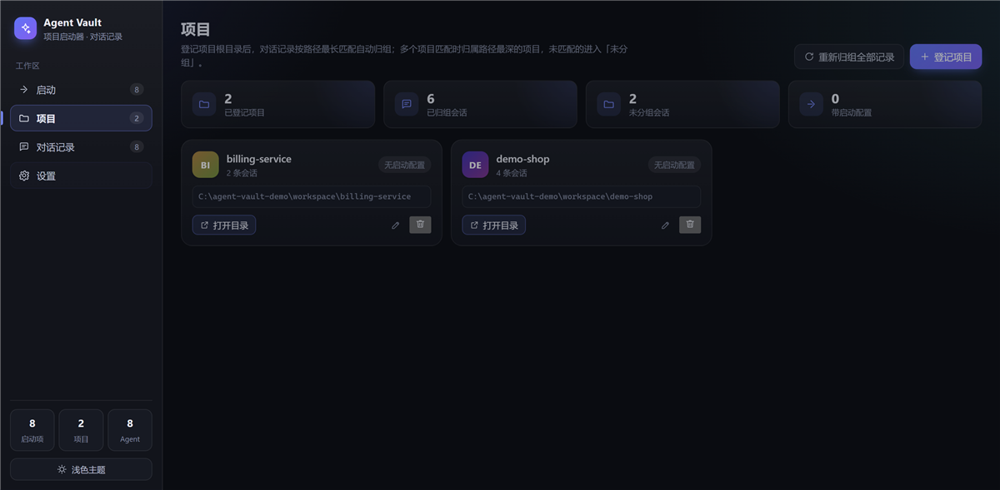
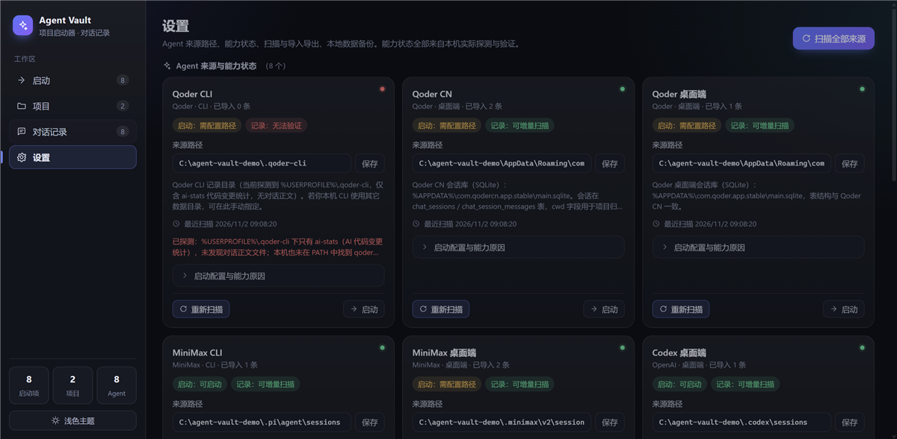

# Agent Vault · 项目启动器与多 Agent 对话记录管理器

Windows 桌面应用（本地优先）：把个人项目、常用软件、CLI 工具和 Agent 入口集中管理，并在同一处查看多种 Agent 的本地对话记录。

- 技术栈：**Electron 38 + React 19 + TypeScript + SQLite（Node 内置 `node:sqlite`）**
- 界面：**自建设计系统**（CSS 变量令牌 + **深色 / 浅色双主题** + 内联 SVG 图标集，无 UI 组件库依赖）
- 数据全部存在本机 `%APPDATA%\project-launcher-agent-vault\agent-vault.db`，查看已导入数据**不需要联网**
- 外部 Agent 的原始记录文件**只读**：本应用不修改、不删除任何 Agent 的原始数据


|  |  |  |
| --- | --- | --- |
|  |  |  |

> 仓库里的截图由 `scripts/make-demo-data.ts` 生成的**虚构演示数据**渲染而成，
> 不含任何真实路径、真实项目名或真实对话内容。复现方式见 [§10.2](#102-重新生成示例截图)。

---

## 目录

1. [功能](#1-功能)
2. [隐私与安全](#2-隐私与安全)
3. [环境要求](#3-环境要求)
4. [快速开始](#4-快速开始)
5. [构建与打包](#5-构建与打包)
6. [本地数据与备份](#6-本地数据与备份)
7. [导入导出格式](#7-导入导出格式)
8. [Agent 能力矩阵](#8-agent-能力矩阵)
9. [归组规则](#9-归组规则)
10. [测试与示例截图](#10-测试与示例截图)
11. [开源参考](#11-开源参考)
12. [已知限制](#12-已知限制)
13. [贡献指南](#13-贡献指南)
14. [许可证](#14-许可证)

---

## 1. 功能

### 1.1 界面

| 页 | 内容 |
| --- | --- |
| 启动 | 统计条（启动项 / 已启用 / Agent 入口 / 最近启动）、**首次使用引导**、最近使用横向卡片、来源与类型筛选、**卡片 / 列表**双视图、卡片内一键启动 |
| 项目 | 项目卡片（会话数 / 根目录 / 关联启动项）、登记与编辑、重新归组、卡片内直接启动 |
| 对话记录 | Agent 标签条（含各 Agent 会话数，无记录的标签弱化）、项目侧栏（含固定「未分组」）、会话列表、详情阅读、来源与元数据折叠、项目归属调整、手动扫描 |
| 设置 | Agent 能力卡片（来源路径、能力徽章、扫描状态、启动配置折叠、重新扫描 / 启动）、导入导出卡片、本地数据与备份 |

界面细节：

- 启动项卡片显示 **Windows 原生文件图标**（主进程 `app.getFileIcon` 提取，按路径缓存），取不到时回退到类型图标或名称首字母色块；原生图标尺寸不一，统一加底板保证视觉重量一致。
- 长路径采用**中间截断**（保留头尾，省略中段），关键信息不丢；完整值在 `title` 提示中。
- 对话详情中的 ``` 代码块按代码块渲染；Agent 注入内容（`<system-reminder>` / `<agent-context>` / `<system_info>`）**默认折叠**为一行摘要，点击可展开原文（展示层折叠，不修改、不丢弃数据）；超过 1200 字符的正文默认折叠并提供展开。
- 操作反馈使用右下角 Toast（成功 / 失败），弹窗支持 Esc 关闭，启动页支持 `Ctrl+N` 新建启动项。
- 主题切换按钮位于侧边栏底部，选择持久化在 `localStorage`，仅影响界面外观。

### 1.2 启动项管理

三类启动项：**普通应用 / CLI 命令 / 项目目录**。

| 字段 | 说明 |
| --- | --- |
| 名称 / 类型 | app / cli / project |
| 可执行文件或命令 | 绝对路径或 PATH 中的命令名 |
| 参数 | **参数数组**（不拼接 shell 字符串） |
| 工作目录 | 启动前校验是否存在 |
| 关联项目 | 可选 |
| 图标 / 标记 | 可选 |
| 启用状态 | 可随时禁用/启用 |
| 最近启动时间 | 启动成功后记录 |

CLI 启动会优先用 Windows Terminal 拉起独立控制台；`.cmd`/`.bat` 通过 `cmd.exe` 执行，**路径与每个参数都单独加双引号**（引号内的 `&`、`|`、`>` 不会被当作命令操作符）；`.js` 入口通过 `node.exe` 执行。启动失败会给出可理解的错误（找不到程序 / 工作目录不存在 / 权限失败 / 退出码 / stderr 首行）。

### 1.3 项目管理与自动归组

登记项目根目录后，对话记录按**路径最长匹配**归组；无法匹配进入固定的「未分组」。手动调整归属后保存覆盖关系，重启与重新扫描都保持不变。

### 1.4 对话记录

- 按 Agent 切换、按项目 / 「未分组」筛选
- 标题与正文全文搜索（本地 `LIKE` 检索，输入做了 250ms 防抖）
- 按创建时间 / 更新时间排序
- 会话详情、来源元数据（来源文件、cwd、外部会话 ID、导入指纹、原始元数据）
- 手动调整项目归属、重新归组全部记录
- 手动重新扫描单个 Agent / 扫描全部
- JSON / Markdown 导入与导出

### 1.5 Agent 适配器与能力矩阵

每个 Agent 一个独立适配器，负责启动配置、来源发现、解析归一化、去重、增量扫描与能力状态。

能力状态：`launchable`（可启动）、`importable`（已验证可导入）、`watchable`（已验证可增量扫描）、`needs_config`（需用户配置来源路径）、`unsupported`（当前环境或格式无法验证）。状态**基于真实探测**，鼠标悬停可看具体原因。

---

## 2. 隐私与安全

这一节请务必先读，它决定了你可以放心把本工具装在哪台机器上。

### 2.1 它会读什么

本应用会**只读**访问本机其它 AI Agent 的会话记录目录，用来把历史对话汇总到一个地方查看：

| Agent | 读取位置 |
| --- | --- |
| Qoder CN / Qoder 桌面端 | `%APPDATA%\com.qodercn.app.stable\main.sqlite`、`%APPDATA%\com.qoder.app.stable\main.sqlite` |
| Codex 桌面端 / Codex CLI | `%USERPROFILE%\.codex\sessions\**\*.jsonl.zst` |
| MiniMax CLI | `%USERPROFILE%\.pi\agent\sessions\**\*.jsonl` |
| MiniMax 桌面端 | `%USERPROFILE%\.minimax\v2\sessions\**\messages.jsonl` |

### 2.2 它不会做什么

- **不联网**：渲染层 CSP 为 `default-src 'self'`，主进程没有出站请求，没有遥测、没有账号体系。
- **不回写原始文件**：SQLite 来源先整体复制到临时目录再解析，**原始文件从不被 SQLite 打开**；其它来源以只读方式读取，不修改内容也不修改 mtime。
- **不外传数据**：导入导出只写到你自己选的文件。
- **不删除 Agent 数据**：应用内也没有「清空全部会话」这类会删数据的操作。

### 2.3 数据放在哪

| 项 | 位置 |
| --- | --- |
| 数据库 | `%APPDATA%\project-launcher-agent-vault\agent-vault.db` |
| 备份 | 设置页「备份数据库」可另存为 `.db` 文件 |
| 临时副本 | 解析 SQLite 来源时的 `%TEMP%\qlv-qoder-*`，用完即删 |

数据库里保存的是**会话正文**，等同于你的聊天记录本身。如果这台机器是共享的，请自行评估是否需要保留；卸载应用不会自动删除该数据库，需要时可在设置页备份后手动清理。

### 2.4 仓库与截图

本仓库**不包含任何真实数据**：截图由虚构演示数据生成，`.gitignore` 也屏蔽了本地截图产物（`*-verify*.png`）。如果你要 fork 并提交自己的截图，请先确认画面里不含真实路径、真实项目名或真实对话内容。

---

## 3. 环境要求

| 项 | 版本 | 说明 |
| --- | --- | --- |
| Node.js | ≥ 22.13（推荐 22.x / 24.x） | 需要内置 `node:sqlite`；Electron 38 内置 Node 22.22 |
| npm | ≥ 10 | 也可用 pnpm |
| 操作系统 | Windows 10 / 11 | 打包与运行验证均在 Windows 完成 |

无需 Visual Studio 编译工具（SQLite 使用 Node 内置绑定，无原生模块）。

> 国内网络建议先设置镜像再安装依赖：
> `npm config set registry https://registry.npmmirror.com`

---

## 4. 快速开始

```bash
npm install          # 安装依赖
npm run dev          # 启动开发版（Vite HMR + Electron）
```

常用脚本：

```bash
npm run typecheck    # 主进程 + 渲染进程类型检查
npm test             # 自动化测试（vitest）
npm run verify       # typecheck + test（提交前跑这个）
npm run build        # 产出 out/main, out/preload, out/renderer
npm start            # 预览构建产物
npm run make:demo    # 生成一份虚构演示数据（见 §10.2）
```

首次启动后应用会自动登记 8 个 Agent 入口并做一次全量扫描。想先看效果但不想暴露真实会话，可以先跑一遍演示数据：

```powershell
$env:VAULT_DEMO_ROOT = 'C:\agent-vault-demo'
npm run make:demo
$env:USERPROFILE = 'C:\agent-vault-demo'
$env:APPDATA = 'C:\agent-vault-demo\AppData\Roaming'
$env:LOCALAPPDATA = 'C:\agent-vault-demo\AppData\Local'
npm run dev
```

---

## 5. 构建与打包

```bash
# 免安装便携目录（最快验证）
npm run pack:dir

# Windows 安装包（NSIS）+ 便携版单文件
npm run pack:nsis      # 仅 NSIS 安装包
npm run pack:portable  # 仅便携版

# 完整发布流程：类型检查 + 测试 + 构建 + 打包
npm run release
```

产物位于 `release/`：

- `Agent Vault-0.1.0-x64.exe` — NSIS 安装包
- `Agent Vault-0.1.0-portable.exe` — 免安装单文件
- `win-unpacked/` — 免安装目录版

> 国内网络建议先设置镜像再打包：
> `ELECTRON_MIRROR=https://npmmirror.com/mirrors/electron/`
> `ELECTRON_BUILDER_BINARIES_MIRROR=https://npmmirror.com/mirrors/electron-builder-binaries/`

### 5.1 GitHub Actions 自动出包

仓库内置两条 workflow：

| workflow | 触发 | 做什么 |
| --- | --- | --- |
| `.github/workflows/ci.yml` | push / PR 到 main | 类型检查 + 单元测试 + 构建 |
| `.github/workflows/release.yml` | 打 `v*` tag | 构建 NSIS + 便携版，作为 Release 产物与 artifact 上传 |

打 tag 即可拿到现成的 exe：

```bash
git tag v0.1.0
git push origin v0.1.0
```

---

## 6. 本地数据与备份

| 项 | 路径 |
| --- | --- |
| 数据目录 | `%APPDATA%\project-launcher-agent-vault\` |
| 数据库 | `%APPDATA%\project-launcher-agent-vault\agent-vault.db` |
| 备份 | 设置页「备份数据库」可另存为 `.db` 文件 |

渲染层可用的主进程接口（全部为本地 IPC，不访问网络）：

| 通道 | 用途 |
| --- | --- |
| `app:info` | 数据目录 / 数据库文件 / 版本号 |
| `app:icon` | 提取文件原生图标（dataURL，主进程内按路径缓存，失败返回 null） |
| `app:openPath` | 在资源管理器中定位文件 |
| `shell:pickDirectory` / `shell:pickFile` | 目录 / 文件选择对话框 |
| `launchers:*` | 启动项增删改查、启停、启动 |
| `projects:*` | 项目增删改查、重新归组、统计 |
| `agents:*` | Agent 列表、来源路径设置、重新扫描 |
| `sessions:*` | 会话列表 / 详情 / 手动归属 / 计数 |
| `io:*` | JSON / Markdown 导入导出、数据库备份、打开数据目录 |

数据库带迁移机制（`schema_migrations` 表），当前迁移版本：

| 版本 | 名称 | 内容 |
| --- | --- | --- |
| 1 | `initial_schema` | launchers / projects / sessions / messages / settings / scan_state |
| 2 | `incremental_scan_columns` | 增加 `content_hash` / `source_mtime` / `search_blob` 与索引 |
| 3 | `launcher_protocol` | launchers 增加 `protocol`（exec / appsfolder） |
| 4 | `source_scan_state` | 增加 `source_state`（按 agent_id + source_path 记录来源 mtime，作为增量判断依据） |

---

## 7. 导入导出格式

### 7.1 JSON（完整保真，推荐）

导出文件包含 `version` / `exportedAt` / `total` / `projects` / `sessions`；**在空数据目录中导入可恢复内容、Agent 与项目归属**（含手动归属）。导出按 500 条一页分页拉取，不会在大库上静默截断。

最小示例：

```json
{
  "version": 1,
  "exportedAt": 1793534555695,
  "total": 1,
  "projects": [
    { "id": "p-1", "name": "番茄钟", "rootPath": "C:\\Users\\me\\code\\tomato-clock" }
  ],
  "sessions": [
    {
      "id": "s-1",
      "agentId": "codex-cli",
      "externalId": "019f7a23-0000-7000-b6b4-c13decba45cc",
      "title": "修复登录问题",
      "createdAt": 1793534555695,
      "updatedAt": 1793534561000,
      "messageCount": 2,
      "sourcePath": "C:\\Users\\me\\.codex\\sessions\\2026\\10\\25\\rollout-x.jsonl.zst",
      "sourceCwd": "C:\\Users\\me\\code\\tomato-clock",
      "autoProjectId": "p-1",
      "manualProjectId": null,
      "rawMeta": { "originator": "Codex Desktop" },
      "messages": [
        { "role": "user", "content": "帮我修一下登录", "createdAt": 1793534555695 },
        { "role": "assistant", "content": "已定位到 token 校验逻辑。", "createdAt": 1793534561000 }
      ]
    }
  ]
}
```

去重规则：导入指纹 = `sha256(agentId + 外部会话ID | 来源路径)`。**重复导入同一份文件不会产生副本**；内容变化则更新同一会话。

### 7.2 Markdown（人工可读交换）

```markdown
# 修复登录问题

- agent: codex-cli
- project: 番茄钟
- project-path: C:\Users\me\code\tomato-clock
- source: C:\Users\me\.codex\sessions\2026\10\25\rollout-x.jsonl.zst
- source-cwd: C:\Users\me\code\tomato-clock
- external-id: 019f7a23-0000-7000-b6b4-c13decba45cc
- created: 2026-10-25T01:22:35.695Z
- updated: 2026-10-25T01:22:41.000Z

## user

帮我修一下登录

## assistant

已定位到 token 校验逻辑。
```

多个会话之间用一行 `---` 分隔（分隔线前后允许空行）。Markdown 导入会**自动登记涉及的项目**并把会话归入该项目。

导出时正文里的行首 `#`、整行 `---`、行首 `\` 会自动加反斜杠前缀，导入时还原，因此**正文含 Markdown 标题或分隔线也不会破坏结构**。唯一仍然丢失的是**消息级时间戳**（Markdown 格式不承载它），需要完整保真请用 JSON。

---

## 8. Agent 能力矩阵（本机实测）

探测环境：Windows 11，探测时间 2026-11-01。**记录能力均来自实际打开来源并解析成功，不是推测。**

| # | Agent | 启动入口 | 启动 | 记录来源 | 记录 | 增量 |
| --- | --- | --- | --- | --- | --- | --- |
| 1 | Qoder CLI | `qoder`（本机未安装，需自行配置路径） | needs_config | `~\.qoder-cli`（仅 ai-stats 代码变更统计，无对话正文） | unsupported | 否 |
| 2 | Qoder CN | `%LOCALAPPDATA%\Programs\Qoder CN\Qoder CN.exe` | launchable | `%APPDATA%\com.qodercn.app.stable\main.sqlite`（chat_sessions / chat_session_messages） | importable | watchable |
| 3 | Qoder 桌面端 | `%LOCALAPPDATA%\Qoder\Qoder Launcher\Qoder Launcher.exe` | launchable | `%APPDATA%\com.qoder.app.stable\main.sqlite`（本机库为空，表结构一致） | importable | watchable |
| 4 | MiniMax CLI | `node.exe …\@earendil-works\pi-coding-agent\dist\bundle\cli.js` | launchable | `~\.pi\agent\sessions\**\*.jsonl` | importable | watchable |
| 5 | MiniMax 桌面端 | `%LOCALAPPDATA%\Programs\MiniMax Code\MiniMax Code.exe` | launchable | `~\.minimax\v2\sessions\**\messages.jsonl` + `manifest.json` | importable | watchable |
| 6 | Codex 桌面端 | MSIX `OpenAI.Codex_2p2nqsd0c76g0!App`（shell:AppsFolder） | launchable | `~\.codex\sessions\**\*.jsonl.zst`（originator = `Codex Desktop`） | importable | watchable |
| 7 | Codex CLI | npm 全局包内原生 `codex.exe` | launchable | 同上（originator ≠ `Codex Desktop`） | importable | watchable |
| 8 | Trae 桌面端 | `%LOCALAPPDATA%\Programs\Trae CN\Trae CN.exe` | launchable | `%APPDATA%\Trae CN\ModularData\ai-agent\database.db`（文件头 `FB 13 12 CE`，非 SQLite） | unsupported | 否 |

关于两个 `unsupported`：

- **Qoder CLI**：本机 `~\.qoder-cli` 下只有 `ai-stats\`（AI 代码变更统计 JSON），未发现任何对话正文文件；PATH 中也没有 `qoder` 可执行文件。保留启动能力并可在设置中配置路径，同时提供通用 JSON / Markdown 导入。
- **Trae 桌面端**：会话库 `database.db` 是私有格式（SQLite 打开直接报 `file is not a database`），`~\.trae-cn` 下也未找到可解析的对话正文。保留启动能力 + 通用导入通道，**不声称已自动同步**。

Codex 桌面端与 CLI **共用** `~\.codex\sessions` 存储，应用按会话文件的 `originator` 字段区分归属（因此两者的增量状态也分开记录，互不干扰）。

> 增量扫描的判定依据是**来源文件的 mtime**。Qoder 的来源是 WAL 模式的 SQLite 库，新数据先落到 `-wal`、主库 mtime 不变，因此实现会把 `-wal` / `-shm` 的 mtime 一并计入；Qoder 进程运行期间新增的会话，可能要等它退出触发 checkpoint 或手动点「重新扫描」才会出现。

---

## 9. 归组规则

1. 取会话的 `cwd`、来源路径、适配器提供的项目路径作为候选；
2. 与已登记项目根目录做「路径包含」匹配（大小写不敏感，目录边界严格）；
3. 多个项目匹配时取**路径最长**（最深）的项目；
4. 无法匹配 → 「未分组」；
5. 手动调整后写入 `manual_project_id`，**优先于**自动归组，重新扫描与重启都保持；
6. 新增 / 删除 / 修改项目后自动触发一次「重新归组全部记录」，手动归属不受影响。

---

## 10. 测试与示例截图

```bash
npm test        # 50 个用例
npm run verify  # 类型检查 + 测试
```

| 测试文件 | 覆盖点 |
| --- | --- |
| `tests/repo.test.ts` | 启动项增删改禁用、项目增删改、Agent/项目筛选、搜索、时间排序、**重启后手动归组保持**、**项目统计（手动覆盖优先 / 未分组计数）** |
| `tests/dedup.test.ts` | 导入指纹稳定性、重复导入不产生副本、内容变化触发更新 |
| `tests/grouping.test.ts` | 路径最长匹配、前缀不误匹配、未分组、手动覆盖优先 |
| `tests/regroup.test.ts` | 项目变更后重新归组、手动覆盖不被改写、删除项目后回退 |
| `tests/adapters.test.ts` | **4 个适配器解析器**：Codex(.jsonl.zst)、MiniMax CLI(pi jsonl)、MiniMax 桌面端(messages.jsonl + manifest)、Qoder(SQLite)，并验证 Qoder 原始库未被修改 |
| `tests/scanner.test.ts` | 增量扫描（按 mtime 跳过）、自动归组、未匹配进入未分组 |
| `tests/io.test.ts` | JSON 导出→空库导入→再次导入不重复、Markdown 导出→导入往返 |
| `tests/launcher.test.ts` | 可执行文件解析与错误提示、**`.cmd` 文件真实启动**（引号被 Node 转义曾导致必然失败） |
| `tests/regression.test.ts` | 回归用例：Markdown 多会话切分、正文含 `##`/`---` 的往返、导入恢复手动归属、导出分页不截断、扫描使用用户配置来源、源端删除的会话被清理、WAL 模式下来源变更可感知 |

fixture 位于 `tests/fixtures/`，均为**构造样本**（不含真实对话内容）。

### 10.1 真实数据往返验证

`scripts/` 下三个脚本针对**本机真实数据**做端到端验证（需要先启动过一次应用以生成数据库）：

```bash
npx vite-node scripts/verify-roundtrip.ts   # 导出 → 空库导入 → 再次导入，确认无副本、归属一致
npx vite-node scripts/verify-rescan.ts       # 强制重新扫描全部来源，确认已存在会话不产生副本
npx vite-node scripts/verify-launch.ts       # 启动成功 / 非零退出码 / 程序不存在 / 工作目录不存在 的真实反馈
```

`verify-roundtrip.ts` 会读取本机应用数据库（只读），导出为 JSON，再导入到一个**全新的空数据库**并二次导入，检查会话集合、项目归属与消息数是否一致、重复导入是否产生副本。

### 10.2 重新生成示例截图

仓库里的截图来自**虚构演示数据**，生成脚本在 `scripts/make-demo-data.ts`：

```powershell
# 1) 生成演示数据（默认写到 C:\agent-vault-demo，可通过 VAULT_DEMO_ROOT 改）
$env:VAULT_DEMO_ROOT = 'C:\agent-vault-demo'
npm run make:demo

# 2) 构建并用假环境变量启动，截图诊断会自动输出 5 张图
npm run build
$env:USERPROFILE = 'C:\agent-vault-demo'
$env:APPDATA = 'C:\agent-vault-demo\AppData\Roaming'
$env:LOCALAPPDATA = 'C:\agent-vault-demo\AppData\Local'
$env:VAULT_SCREENSHOT = '.\docs\screenshots\launch.png'
npx electron .
```

产出的文件：`launch.png`（启动）、`launch-conversations.png`（对话记录）、`launch-settings.png`（设置）、`launch-projects.png`（项目）、`launch-light.png`（浅色主题）。

> 截图诊断**只在显式设置 `VAULT_SCREENSHOT` 时启用**，正式版不会读取工作目录里的任何文件、也不会往任意路径写 PNG。

---

## 11. 开源参考

本项目仅参考这些项目的**公开交互与设计思路**，未复制任何不明来源代码。

| 项目 | 链接 | 许可证 | 借鉴点 |
| --- | --- | --- | --- |
| Cherry Studio | https://github.com/CherryHQ/cherry-studio | **AGPL-3.0** | 会话建模为独立实体并带本地 DB schema（`src/main/data/db/schemas/topic.ts`：uuid 主键、名称 + 手动改名标记、排序键、`lastActivityAt` 活动时间戳）；主进程持有本地数据库、渲染进程只读交互的分工 |
| Chatbox | https://github.com/Bin-Huang/chatbox | **GPL-3.0** | `docs/storage.md` 的**版本化迁移机制**（`configVersion` + 迁移函数表、同类型存储共享数据源不复制、多份旧存储取最新）——本项目的 `schema_migrations` + 顺序迁移借鉴了这一思路；桌面端「配置文件便于备份 / 会话数据放大容量」的分离策略 |
| Jan | https://github.com/janhq/jan | **Apache-2.0** | `core/src/types/thread/threadEntity.ts` 的线程实体（id / title / created / updated / metadata）与「线程列表 + 收藏 + 最近」的信息组织方式；完全离线本地优先的定位 |

许可证均为其仓库根目录 `LICENSE` 文件中声明的原始文本（已逐一读取核实）。**本项目自身未复制上述任何代码。**

---

## 12. 已知限制

- Qoder CLI 与 Trae 桌面端**没有**可验证的自动记录同步（原因见能力矩阵），只能通过通用 JSON / Markdown 导入。
- 会话正文搜索是 `LIKE '%关键词%'` 的子串匹配，不是分词或语义检索；内容多时建议配合 Agent / 项目筛选。
- 标题对没有原生标题的来源（Codex / pi / MiniMax 桌面端）由首条用户消息派生，可能不是原始标题。
- MiniMax 桌面端会话没有 cwd 字段，这些记录默认进入「未分组」，只能手动调整。
- Markdown 导入导出**不携带消息级时间戳**，需要完整保真请用 JSON。
- 打包产物未做代码签名（未配置证书），Windows SmartScreen 可能提示未知发布者。
- `node:sqlite` 在 Electron 中仍会打印一条 ExperimentalWarning，不影响功能。
- 对话详情的 Markdown 渲染只识别 ``` 代码块，不做完整 Markdown 解析（列表、表格等按原文展示）。
- 界面外观按 1440×900 设计；窗口更窄时卡片列数自适应减少，但对话记录页三栏在 1100px 以下会显得拥挤（最小窗口尺寸为 1100×680）。
- 对话详情注入内容折叠只覆盖 `<system-reminder>` / `<agent-context>` / `<system_info>` 三种标签；其它 Agent 自定义的包装标签会按原文展示。
- 「CLI 优先用 Windows Terminal 拉起」需要本机 `wt.exe` 能被探测到。`wt.exe` 是 WindowsApps 下的 App Execution Alias，部分机器上 `fs.existsSync` 看不到它，此时会自动退回普通启动（功能不受影响，只是没有独立终端窗口）。

---

## 13. 贡献指南

欢迎提 issue 和 PR。为了让改动容易评审：

1. **先开 issue 描述问题**，尤其是涉及 Agent 记录格式的改动（请附上脱敏后的样本片段）。
2. 分支命名：`feat/<主题>`、`fix/<主题>`、`docs/<主题>`。
3. 提交前跑通 `npm run verify`（类型检查 + 50 个用例）。
4. 一次 PR 只做一件事；新增能力请同时补测试与 README 说明。
5. **不要提交真实数据**：任何截图、fixture、日志都必须脱敏（仓库的 `.gitignore` 已屏蔽本地截图产物，但请自行确认）。

新增一个 Agent 适配器需要做的事：

- 在 `src/main/adapters/` 实现适配器（启动配置、来源发现、解析归一化、去重、增量扫描）；
- 在 `src/main/adapters/registry.ts` 注册，并在 `src/main/agents/capabilities.ts` 走通用能力探测；
- 在 `tests/adapters.test.ts` 补解析用例，用**构造样本**做 fixture；
- 更新本 README 的能力矩阵，并注明是「实测」还是「未验证」。

---

## 14. 许可证

[MIT](LICENSE) © 2026 woluoleiqingxvlingsui
